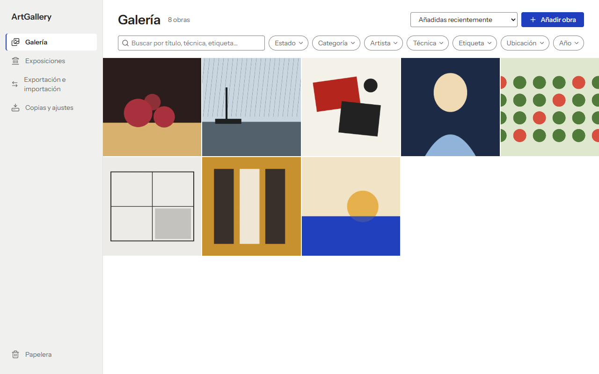
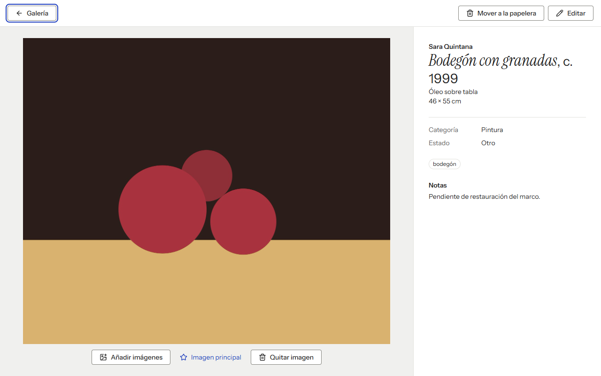
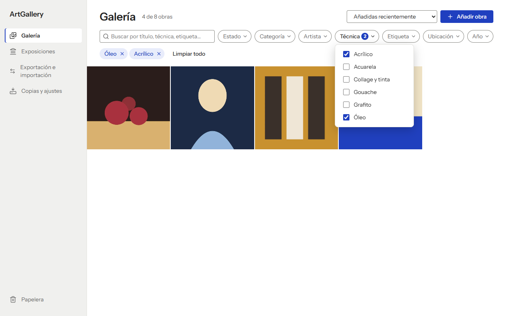
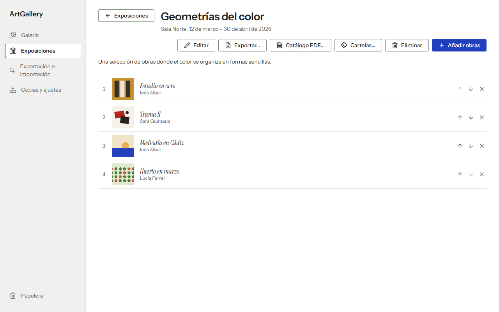
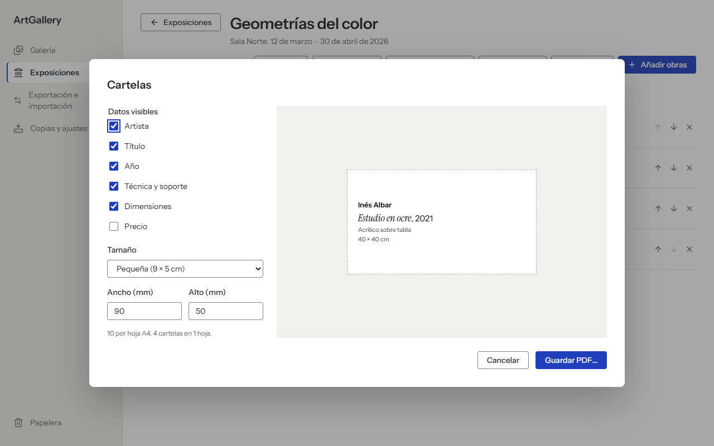

# ArtGallery

[](https://github.com/antoniomeht/ArtGallery/actions/workflows/ci.yml)

Inventario personal de cuadros, pinturas y dibujos para Windows y macOS. Funciona sin conexión, sin cuentas y sin servicios externos: los datos y las imágenes se guardan en el propio equipo.



## Qué problema resuelve

Quien pinta o colecciona suele llevar sus obras repartidas entre carpetas de fotos, hojas de cálculo y notas. ArtGallery reúne en un solo lugar la ficha de cada obra con sus imágenes, dónde está y en qué estado se encuentra (disponible, expuesta, prestada, vendida). También prepara lo que hace falta para una exposición: la selección ordenada de obras, el catálogo en PDF y las cartelas para imprimir. Incluye copias de seguridad que se pueden recuperar tras reinstalar o cambiar de equipo.

| Ficha de la obra                             | Búsqueda y filtros en la Galería                     |
| -------------------------------------------- | ---------------------------------------------------- |
|  |       |
| **Exposición**                               | **Cartelas**                                         |
|     |  |

Las capturas son de la aplicación real con los [datos de demostración](#datos-de-demostración).

## Funciones

**Inventario**

- Alta directa: arrastra una imagen a la ventana o pulsa «Añadir obra». La ficha se abre en edición con la foto como principal, el nombre del archivo como título y el artista predeterminado de los ajustes. Si añades varias imágenes a la vez, se crea una obra por imagen.
- Las fotografías se copian al almacenamiento de ArtGallery, así que la obra sigue funcionando aunque se mueva o borre el archivo original.
- Los campos de texto sugieren los valores ya usados en el inventario, e Intro toma el que más se parece a lo escrito.
- Ficha con estilo de cartela de museo y edición de todos los campos:
  - artista, categoría, técnica y soporte;
  - año (exacto o aproximado);
  - alto, ancho y profundidad con unidades;
  - descripción, notas y etiquetas;
  - ubicación y estado;
  - precio con moneda.
- Varias imágenes por obra: se pueden añadir más, también arrastrándolas a la ficha abierta, elegir la principal y quitar imágenes.
- Papelera recuperable, con «Deshacer» al momento y borrado definitivo con confirmación.

**Galería y búsqueda**

- Cuadrícula de miniaturas al estilo de la galería de un móvil, ordenable por fecha de incorporación, título o año. El orden por título no distingue tildes ni mayúsculas.
- Selección múltiple: mantén pulsada una obra (o Mayús+Intro) y marca las demás con un clic. Acciones en bloque:
  - cambiar el estado;
  - añadir a una exposición;
  - exportar;
  - imprimir cartelas;
  - mover a la papelera.
- Búsqueda en la propia Galería, mientras escribes y en todos los campos, combinable con desplegables de estado, categoría, artista, técnica, etiqueta, ubicación y rango de años. Cada valor elegido aparece como una burbuja que se quita con su x.

**Exposiciones**

- Nombre, lugar, fechas, descripción y una selección ordenada de obras.
- Catálogo en PDF (A4): portada con la obra principal y los datos de la exposición, y después cada obra con su miniatura y su cartela. El precio es opcional.
- Cartelas en PDF:
  - datos visibles a elegir;
  - tamaños predefinidos o personalizados;
  - vista previa a tamaño real;
  - reparto automático en hojas A4 con márgenes y líneas de corte.

**Datos, copias e intercambio**

- Copias de seguridad manuales y automáticas: verificadas al crearlas, con retención configurable y restauración segura ([detalles](#copias-de-seguridad-y-recuperación)).
- Exportación del inventario, de una selección o de una exposición a un archivo [`.artgallery`](#formato-portátil-artgallery) portátil.
- Importación con resumen previo y elección de qué hacer con lo que ya existe: mantener, sustituir o duplicar.
- Exportación de metadatos a CSV para hojas de cálculo. No incluye imágenes y no sustituye a una copia de seguridad.

La interfaz está en español y se puede usar con teclado: foco visible, diálogos nativos accesibles, botones con etiqueta y avisos anunciados a lectores de pantalla.

## Estado del proyecto

Versión `0.1.0`, en desarrollo y todavía sin publicar como release.

- **Probado:**
  - en local en Windows 11, con pruebas automáticas y recorridos completos en la aplicación real;
  - en el CI, que compila y empaqueta en Windows y macOS en cada PR.
- **No probado:** la versión de macOS solo se ha compilado en el CI; no se ha probado en un Mac.
- **Pendiente** de la intervención del propietario del repositorio:
  - firmar los instaladores: en Windows hace falta un certificado de firma de código; en macOS, una cuenta de Apple Developer (Developer ID y notarización). Mientras tanto, SmartScreen y Gatekeeper avisan al abrirlos;
  - publicar la primera versión subiendo una etiqueta (ver [CI y publicación](#ci-y-publicación)).

### Limitaciones conocidas

- macOS solo se empaqueta para Apple Silicon (arm64): sharp necesita un binario nativo por arquitectura y falta un runner Intel.
- La interfaz solo está en español y no tiene modo oscuro.
- La búsqueda usa `LIKE` sin índice de texto completo. Es suficiente para un inventario personal de cientos o pocos miles de obras.
- Los duplicados al importar se detectan por identificador interno, no por título.
- No hay importación desde CSV ni orden de imágenes por arrastre.
- Los documentos PDF son solo A4 vertical.
- Las copias no están cifradas, y si una copia automática falla solo se registra en la consola.

## Tecnologías y decisiones

| Pieza      | Elección                         | Motivo                                                                                             |
| ---------- | -------------------------------- | -------------------------------------------------------------------------------------------------- |
| Escritorio | Electron 44                      | Un solo código TypeScript para Windows y macOS, PDF integrado (`printToPDF`) y empaquetado maduro. |
| Interfaz   | React 19 + CSS propio            | Componentes sencillos y una identidad visual a medida sin dependencias de estilos.                 |
| Datos      | SQLite (`node:sqlite`)           | Incluido en el Node de Electron: sin módulos nativos que recompilar y la misma API en las pruebas. |
| Imágenes   | sharp                            | Miniaturas WebP rápidas y validación de que cada archivo es una imagen.                            |
| Paquetes   | yazl / yauzl                     | ZIP en _streaming_, sin cargar inventarios grandes en memoria.                                     |
| Validación | zod                              | Un mismo esquema valida formularios, IPC y paquetes importados.                                    |
| Build      | electron-vite + electron-builder | Recarga rápida en desarrollo e instaladores NSIS (Windows) y DMG (macOS).                          |
| Pruebas    | Vitest                           | Pruebas con bases de datos e imágenes reales en carpetas temporales.                               |

Se descartó **Tauri**: genera binarios más pequeños, pero exige mantener una segunda base de código en Rust y su generación de PDF depende del WebView de cada sistema.

**Identidad visual: «cubo blanco».** Los valores están en `src/renderer/src/styles/tokens.css`, con primitivos y tokens semánticos; la escala de texto y el espaciado siguen Fluent 2.

- La interfaz es neutra para que el color lo pongan las obras, con un único acento azul Klein (`#1F3FBF`).
- Usa Instrument Sans para la interfaz y los títulos de obra en Instrument Serif cursiva, como en las cartelas de museo.
- Las tipografías van empaquetadas, sin cargar nada de Internet.

**Arquitectura**

```
src/
  shared/    tipos, esquemas zod y formato de textos comunes a los dos procesos
  main/      proceso principal: base de datos y migraciones, almacén de imágenes,
             servicios de inventario y exposiciones, copias, paquetes, impresión e IPC
  preload/   API mínima y tipada expuesta a la interfaz como window.artGallery
  renderer/  interfaz React organizada por funciones (features/)
```

**Seguridad**

- Ventanas con `contextIsolation` y `sandbox`, sin `nodeIntegration`, y con una CSP estricta.
- Las entradas IPC se validan con zod.
- Las imágenes se sirven por un protocolo propio que solo da acceso a la carpeta de imágenes de la app.

## Instalación

Cuando haya una versión publicada, los instaladores estarán en [Releases](https://github.com/antoniomeht/ArtGallery/releases). Hasta entonces, cada ejecución del [CI](https://github.com/antoniomeht/ArtGallery/actions/workflows/ci.yml) guarda durante 14 días los instaladores de Windows (`.exe`) y macOS (`.dmg`) como artefactos descargables. También puedes generarlos desde el código.

## Desarrollo

Requisitos: Node.js 24 y npm.

```bash
npm ci            # dependencias exactas del lockfile
npm run dev       # la aplicación en modo desarrollo, con tus datos de desarrollo
npm run demo      # la aplicación con datos de demostración en .demo/
```

Comprobaciones, las mismas que ejecuta el CI:

```bash
npm run format:check
npm run lint
npm run typecheck
npm test
```

Las pruebas usan bases de datos e imágenes temporales y se centran en lo que protege el inventario:

- migraciones y persistencia al reabrir;
- coherencia de las imágenes;
- operaciones fallidas que no dejan datos a medias;
- validación y seguridad de los paquetes;
- importación, exportación, copias y restauración, incluido el escenario de reinstalar.

Generar el instalador del sistema actual en `release/<versión>/`:

```bash
npm run package
```

### Datos de demostración

`npm run demo` abre la aplicación sobre una carpeta propia (`.demo/`, ignorada por Git) con 8 obras y una exposición.

- Los artistas y los títulos son ficticios.
- Las imágenes son composiciones abstractas generadas por código, sin derechos de terceros.
- El modo demo no lee ni modifica tus datos ni tus copias, y no existe en la aplicación instalada.

## Dónde se guardan los datos

La base de datos y las imágenes están en la carpeta de datos del usuario, fuera de la carpeta de instalación:

| Sistema | Carpeta                                    |
| ------- | ------------------------------------------ |
| Windows | `%APPDATA%\ArtGallery`                     |
| macOS   | `~/Library/Application Support/ArtGallery` |

Contenido de la carpeta:

- `artgallery.sqlite`: el inventario;
- `images/originals`: copias exactas de las fotografías;
- `images/thumbnails`: miniaturas WebP;
- `settings.json`: los ajustes.

Si una actualización cambia la estructura de la base de datos, antes de migrarla se guarda una copia completa junto a ella (`artgallery.before-update-v<N>.sqlite`). Una base de datos creada por una versión más nueva de la app no se abre, para no estropearla.

## Copias de seguridad y recuperación

Desde **Copias y ajustes**:

- **Qué incluye una copia**: un archivo `.artgallery` con todo el inventario, papelera y exposiciones incluidas, y los originales de todas las imágenes. Tras escribirla, ArtGallery la vuelve a leer completa y comprueba cada imagen antes de darla por buena.
- **Dónde se guarda**: por defecto en `Documentos/ArtGallery/Copias de seguridad`, fuera de la instalación y de la carpeta de datos. Se puede elegir otra carpeta, por ejemplo un disco externo o una carpeta sincronizada.
- **Copias automáticas**: diarias (por defecto), semanales o desactivadas.
  - Se comprueban al iniciar la aplicación y cada hora mientras está abierta.
  - No se crean si el inventario está vacío.
  - Se conservan las más recientes (10 por defecto).
  - Las copias manuales nunca se borran automáticamente.
- **Restaurar**:
  1. ArtGallery valida la copia entera; si algo falla, el inventario no se toca.
  2. Guarda el inventario actual como copia «antes de restaurar».
  3. Sustituye el inventario en una sola transacción.

  Se puede restaurar desde la lista o desde cualquier archivo `.artgallery`. Importar, en cambio, solo añade obras y nunca borra nada.

### Qué ocurre al desinstalar y reinstalar

- **Se conserva, si el sistema lo permite:** la carpeta de datos. El desinstalador de Windows está configurado para no borrarla, aunque el usuario, otras herramientas o una limpieza del sistema sí pueden eliminarla. En macOS, arrastrar la app a la papelera no la elimina.
- **Depende de ti:** las copias de seguridad. Tras reinstalar, ArtGallery busca las copias en la carpeta por defecto y las muestra para restaurarlas. Si las moviste, basta con elegir su carpeta o abrir el archivo.
- **No se puede recuperar:** si se han eliminado tanto la carpeta de datos como todas las copias, el inventario se pierde. Conviene guardar copias también fuera del equipo.

## Formato portátil `.artgallery`

Las copias de seguridad y las exportaciones usan un mismo formato documentado y versionado: un ZIP con extensión `.artgallery`.

| Entrada             | Contenido                                                                                                                                                                                                                         |
| ------------------- | --------------------------------------------------------------------------------------------------------------------------------------------------------------------------------------------------------------------------------- |
| `manifest.json`     | `format: "artgallery"`, `formatVersion` (actualmente `2`; se siguen leyendo paquetes `1`), `kind` (`backup` para el inventario completo o `artworks` para obras o exposiciones), fecha, versión de la app y recuentos.            |
| `data.json`         | Obras con todos sus campos, etiquetas, fechas y la lista ordenada de imágenes (la primera es la principal), cada una con su ruta relativa, tamaño y SHA-256. Desde la versión 2, también las exposiciones con sus obras en orden. |
| `images/<id>.<ext>` | Copia exacta de cada imagen original. Las miniaturas no se incluyen: se regeneran al importar.                                                                                                                                    |

Al leer un paquete, ArtGallery:

- rechaza versiones de formato más nuevas que las que entiende;
- solo acepta esas rutas exactas, así que nunca escribe fuera de su carpeta temporal (sin rutas absolutas ni `..`);
- comprueba el tamaño y el SHA-256 de cada imagen, y que no falte ni sobre ninguna;
- valida todos los datos antes de aplicar nada.

Si algo falla, descarta el paquete completo y no deja una importación a medias.

## CI y publicación

- **CI** (`.github/workflows/ci.yml`), en cada pull request y en `main`:
  - formato, lint, tipos y pruebas en Ubuntu;
  - empaquetado en Windows y macOS, con los instaladores guardados como artefactos;
  - permisos de solo lectura.
- **Publicación** (`.github/workflows/release.yml`):
  - se dispara al subir una etiqueta de versión (`git tag v0.1.0 && git push origin v0.1.0`);
  - vuelve a ejecutar las pruebas, empaqueta en ambos sistemas y crea un release en **borrador** con los instaladores, para revisarlo y publicarlo a mano;
  - solo ese último paso tiene permiso de escritura.

  Todavía no se ha ejecutado ninguna vez.

## Contribuir

Las pautas para proponer cambios están en [CONTRIBUTING.md](CONTRIBUTING.md).

## Licencia

[MIT](LICENSE)
